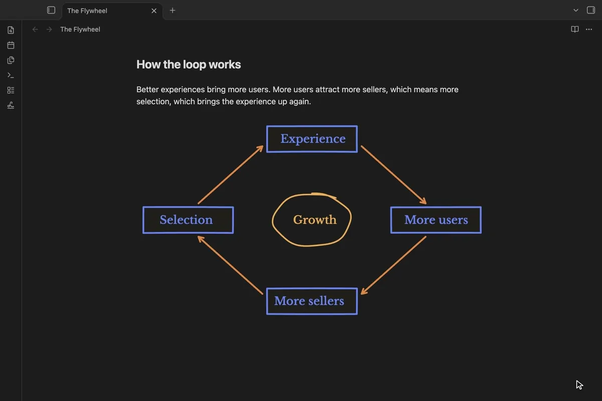
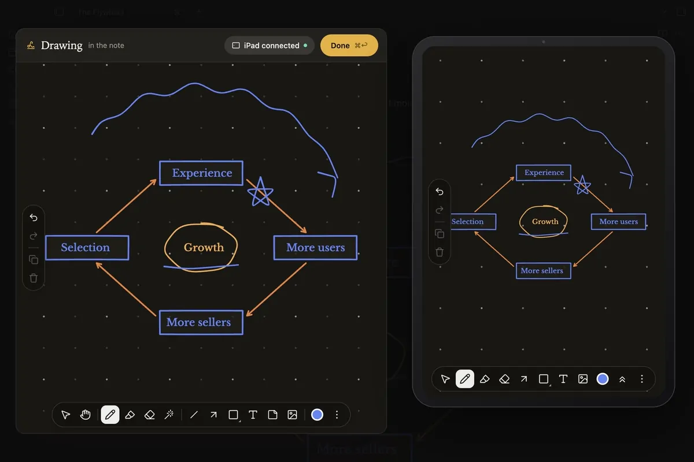
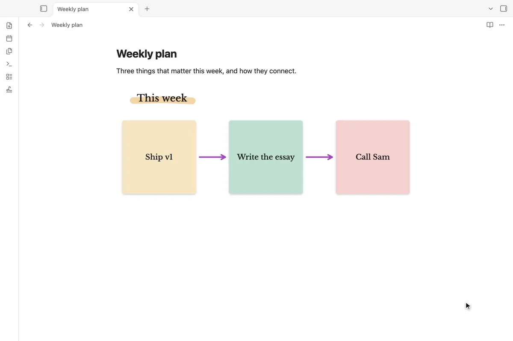
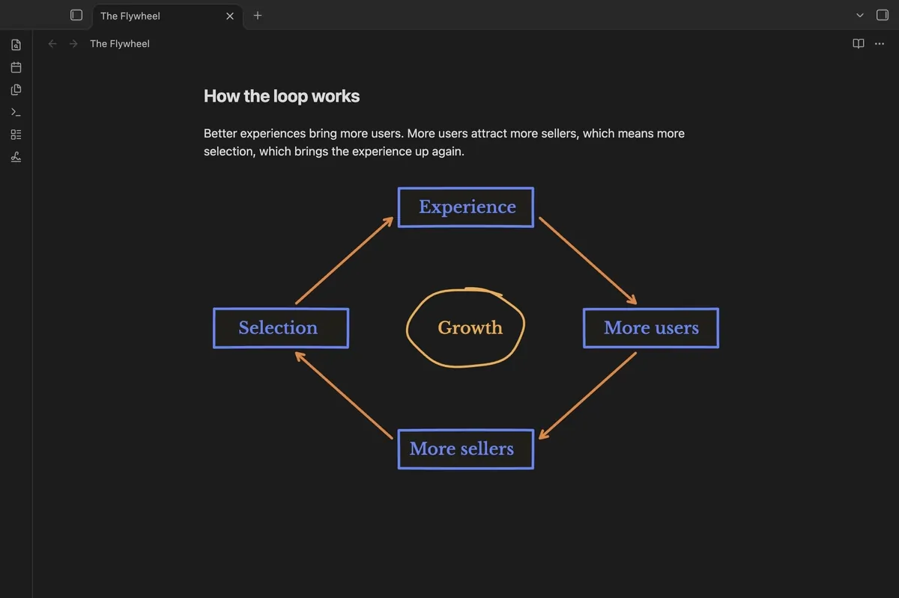

# Quickdraw for Obsidian

Draw in your notes. **Insert drawing** opens a big sheet with the [Quickdraw](https://github.com/quickdrawjs/quickdraw) board: an infinite canvas with pen, highlighter, shapes, arrows, text, sticky notes and a laser. What you draw lands in the note where your cursor was, and keeps saving as you go.

**Draw on iPad** puts a code on screen. Scan it with your iPad's camera and the same drawing opens in Safari, ready for Apple Pencil. Strokes show up on your computer as you draw, and undo works from either side. There's no app to install on the iPad.

Sticky notes, highlighter, shapes, arrows, text and a laser pointer, in light and dark:

## Using it

- **Insert drawing**: from the command palette, the slash commands, the ribbon, or the editor's right-click menu.
- **Draw on a drawing again**: double-click it in the note, or use the pencil button that shows when you hover over it. There's also a command for the drawing on the cursor's line.
- **Done** (⌘↩ / Ctrl ↩) closes the sheet. A new drawing you leave empty is never added. A drawing you clear is taken out of the note, and its files go to the trash.

## How drawings are kept

Each drawing is three files, all in your vault:

- `<id>.drawing.png`: a picture of the drawing. The note embeds this, so the drawing shows anywhere Markdown is read, including Obsidian Publish and Obsidian on your phone.
- `<id>.drawing-dark.png`: the same picture in dark-theme colours. Quickdraw shows it when Obsidian is in dark mode.
- `<id>.drawing.json`: the strokes themselves, so you can keep drawing on it.

New drawings go in the folder set for attachments in **Settings → Files and links**, or in the folder you pick in Quickdraw's settings.

## Network use (Draw on iPad only)

Quickdraw makes no network requests. When you click **Draw on iPad**, and only then, it starts a small web server on your local network so the iPad can open the drawing:

- The server serves only the drawing page and the Quickdraw engine, both built into the plugin, and relays strokes between the iPad and your computer over a WebSocket. Nothing leaves your local network, and there are no accounts, analytics or cloud services.
- Every address carries a random key that's only in the code on your screen. Requests without it are refused.
- On macOS, the computer announces a friendly name (`obsidian.local`) with Bonjour (`dns-sd`) so the link is easy to type. Elsewhere, the link uses your computer's local IP address.
- The server stops when you click **Stop Sharing** or close the drawing.

Your firewall may ask to allow incoming connections the first time you use it.

## Credits

Built on [Quickdraw](https://github.com/quickdrawjs/quickdraw), the MIT-licensed infinite-canvas whiteboard SDK. The board's serif is Libre Baskerville (SIL Open Font License 1.1).

## License

MIT
